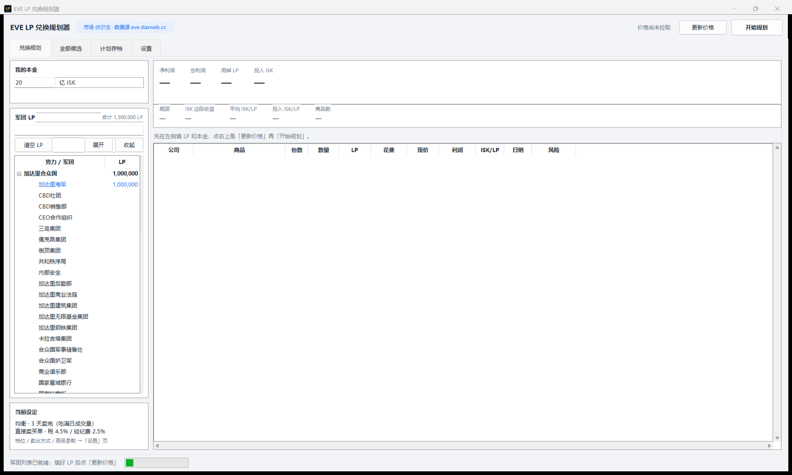

# EVE 商人助手（桌面版）

一个**本地 Windows 桌面程序**：填上你各军团的 LP 和本金，一键算出「换哪些商品、各换几份、能赚多少」。

原生窗口（tkinter），引擎在进程内跑，不起 HTTP 服务、不开浏览器、不需要装 Python。



> **数据源只有一个**：[eve.starweb.cc](https://eve.starweb.cc/lpstore)。商店报价、价格、日销售量、出货指数、价格冲击曲线，以及星域 / 势力 / 军团的中文名，全部取自该站点。
> 市场固定为它的默认星域 `10000002`（中文名：**伏尔戈**），不跨星域比价。

## 启动方式

**双击桌面上的「EVE 商人助手」图标即可。** 程序已安装在：

```
%LOCALAPPDATA%\EVE商人助手\EVE商人助手.exe
```

首次使用：

1. 左侧「我的本金」填钱包里有多少 ISK（单位：**亿**）
2. 「军团 LP」里双击公司行填 LP 数量（也可以点「清空 LP」重来）
3. 点右上角「更新价格」拉一次报价（5–10 秒，之后 10 分钟内走缓存）
4. 点「开始规划」看结果

数据文件（`gui_state.json`）就在 exe 旁边，备份或换机时拷走即可。

## 界面

- **兑换规划**：左侧本金 + 军团 LP（按「势力 → 军团」两级分组，双击势力名可折叠/展开，填了 LP 的势力自动展开）；右侧净利润 / 总利润 / 用掉 LP / 投入 ISK 四个大数，加上瓶颈、ISK 边际收益、平均 ISK/LP、投入 ISK/LP、商品数五个小数，下面是兑换清单
- **全部候选**：所有可换商品，右键可排除（跨军团按物品生效）
- **计划存档**：保存/完成/删除计划，统计本月完成与净利润
- **设置**：风格档位、卖出方式、高级参数、各公司 LP 获取成本

## 核心算法

1. **价格冲击曲线**：starweb 的 `scope` 参数表示「卖出当日成交量的多少比例」，其 `Price` 就是吃掉这么多量后的成交均价。对同一公司取 0.2% / 1% / 5% / 20% 四个采样点，就能还原「卖得越多、均价越低」的阶梯收入 `R(q)`，而不是「单价 × 数量」。采样缺失时退化为「每吃 1 倍日成交量价格线性下跌」的模型。
2. **ISK 影子价格 λ**：把 ISK 预算当约束做拉格朗日松弛，二分出 λ，使「不限预算时按净边际收益排序」的总支出刚好贴近预算。λ 就是**每 1 亿本金的边际利润**。
3. **按 LP 的净收益贪心**：每份的边际值 = `(边际利润 − λ × 该份支出) / LP − 每点 LP 的获取成本`，只保留边际值为正的商品；堆式贪心，天然满足「先吃好价、后吃差价」。
4. **双约束诊断**：同时跟踪 LP 与 ISK 的消耗比例，判定瓶颈是 `ISK` / `LP` / `双卡` / `都够`，并给出「还差多少本金才能吃满 LP」这类可执行提示。
5. **硬约束而非软衰减**：单一商品最多占该公司 LP 的指定比例（默认 25%）；跨公司的同一物品按 `offer_id` 分别记账（旧版按 `item_id` 记账会串账）。
6. **风险标记**：现价高于 / 低于近 7 日成交均价 30%、出货指数偏低、日成交量不足一份、缺少价格曲线——都用 starweb 自带字段判断，在表格里标出来。

## 参数口径

界面上只留三件事：**风格档位、卖出方式、本金与 LP**，其余收在「设置 → 高级参数」里。

档位只决定**排序口径**（其余参数是它的默认伴随值）：

| 档位 | 排序键 | 单品 LP 上限 | 最少品种 | 最低日销售额 |
|------|--------|-------------|---------|------------|
| LP 优先 | 每 LP 净利润（利润/LP − LP 成本） | 40% | 3 | 0.5 亿 |
| 均衡 | 前一列与「每 LP 日成交额」归一化后各占一半 | 25% | 5 | 1 亿 |
| 速度优先 | 每 LP 日成交额（TxnAmount / LP），市场规模越大越先拿 | 25% | 8 | 2 亿 |

**卖完天数已删除**：单商品数量不再按天数封顶，LP 默认全部吃光（只受 LP 预算、单品占比上限、
ISK 预算和价格冲击曲线约束）。计划表仍显示「日销」和等价的卖完天数估算，用于判断货能不能消化。

| 高级参数 | 说明 |
|------|------|
| 销售税 % | 卖出时的销售税，默认 4.5（Accounting V 可降到 2.25） |
| 经纪人费 % | 只有「挂卖单」才收，默认 2.5；「直接卖给买单」不收 |
| 最低日销售额 | 日成交额低于该值的商品视为卖不动 |
| 单品 LP 上限 | 单个商品最多占用该公司 LP 的比例 |
| 最少品种数 | 希望覆盖的商品种类，不足时给出提示 |
| 无曲线时价格冲击 | 拿不到采样曲线时，每吃 1 倍日成交量价格下跌的百分比，默认 10% |

利润 = Σ 价格冲击曲线收入 ×（1 − 销售税）− 经纪人费 − 商店 ISK 成本 − 材料成本
净利润 = 利润 − Σ(使用的 LP × 该公司每点 LP 成本)

「设置」页有一个 **LP 视为已有** 开关（默认开启）：
- 开启：只按毛利挑商品，LP 尽量用光，成本只用来折算净利润；
- 关闭：每点 LP 赚不回你设定的成本就不做——LP 用完率会明显变低，但净利润更高。

所有设置改动**立即存到本机**（`gui_state.json`），下次打开不用重填。

## 从源码运行（开发用）

```powershell
python -m venv .venv
.venv\Scripts\python.exe -m pip install -r requirements.txt   # 只有一个依赖：requests
.venv\Scripts\python.exe gui.py
```

## 重新打包 exe

需要 Python 3.12（`.venv-build`，含 PyInstaller）：

```powershell
uv python install 3.12
uv venv --python 3.12 .venv-build
uv pip install --python .venv-build\Scripts\python.exe pyinstaller
.venv-build\Scripts\python.exe tools\build_desktop.py --install
```

`--install` 会依次做三件事：打包到 `dist\`、复制到 `%LOCALAPPDATA%\EVE商人助手`、重建桌面快捷方式。

> 注意：本机安全软件会拦 Python 往 AppData 写 exe（`PermissionError: WinError 5`），所以安装这一步是用 PowerShell 的 `Copy-Item` 完成的，别改成 `shutil.copy2`。

## 项目结构

```
gui.py             桌面界面（tkinter/ttk，全部页面逻辑）
planner.py         兑换优化：价格冲击曲线 / λ 影子价格 / 按 offer_id 记账
enrich.py          starweb 报价 → 价格曲线 / 均价 / 风险标记
starweb.py         eve.starweb.cc 客户端（唯一数据源，进程内缓存）
paths.py           资源路径 / 数据路径（源码运行与 exe 运行都适用）
tools/build_desktop.py  打包 + 安装 + 桌面快捷方式
tools/bench_planner.py  命令行回归基准
tools/make_icon.py      生成 assets/eve-lp.ico
assets/eve-lp.ico  程序与快捷方式图标
docs/              界面截图
legacy/web/        旧的网页版（FastAPI + ESI 钱包），已停用，仅留档
```

## 免责声明

- 数据来自第三方站点，与游戏内实时行情可能有偏差，以游戏内市场为准
- 只读公开行情，不注入客户端、不代下单
- 请遵守 [eve.starweb.cc](https://eve.starweb.cc) 的合理使用约定
